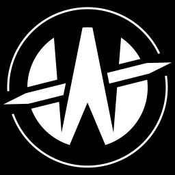
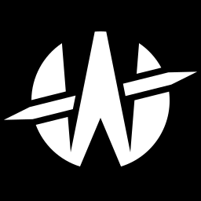
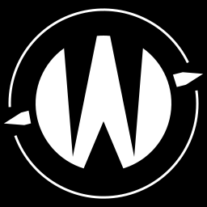

# The Weft mark

The mark is a **W** (the engine is called Weft) drawn as a small planet. The outer strokes swell into the round limb of the body; a thin slanted band, the weft thread, passes **over** the outer strokes and **under** the middle apex, as a thread goes through a weave. A hairline circle, concentric with the body, is the orbit. The artwork is original, drawn by hand for the engine, and is licensed with the repository (Apache-2.0).

{ width="256" }

## Files

Everything is in `Docs/assets/brand/`. The SVGs are hand-written (`path` only, no filters, no text, no embedded raster, each under 2 KiB), with the geometry on a 256 grid: the viewBox is `0 0 256 256`, the body is a circle of radius 88 around (128, 128), the hairline circle has radius 116.

| File | What | Use |
|---|---|---|
| `weft-mark.svg` | white glyph on a black square | app icon, social image, anywhere a finished square is needed |
| `weft-mark-dark.svg` | white glyph, transparent | on dark backgrounds |
| `weft-mark-light.svg` | black glyph, transparent | on light backgrounds |
| `weft-mark-mono.svg` | `currentColor`, transparent | inline in HTML or an editor UI that supplies the colour (themes, hover, disabled) |
| `weft-wordmark.svg` | the mark and the letters WEFT, `currentColor` | headers, the README banner, splash screens |
| `png/weft-mark-<n>.png` | `weft-mark.svg` rendered at 16, 32, 48, 64, 128, 256, 512, 1024 px | window icons, installers, places that do not take SVG |
| `png/weft-mark-dark-<n>.png`, `png/weft-mark-light-<n>.png` | the same sizes, transparent | |

The letters of the wordmark are drawn as paths, so the file has no font dependency.

## Colours

The mark is a single flat colour on a background; it has no gradient and no second colour.

| Name | Value | Where |
|---|---|---|
| Ink | `#000000` | the glyph on light, the background of `weft-mark.svg` |
| Paper | `#FFFFFF` | the glyph on dark |

With `weft-mark-mono.svg` and the wordmark any colour is fine as long as it has at least 4.5:1 contrast with the background (for example a theme's text colour). Do not use more than one colour in one mark, do not put it on a busy photograph, and do not outline, shadow, rotate, stretch or recolour parts of it.

## Clear space

Keep free space of **32 units** (one eighth of the mark's width: 12.5 %) on every side of the mark, measured from the edge of its 256 box. For the wordmark the same 32 units of its height apply on every side. Nothing (text, other logos, the edge of an image) enters that margin.

## Minimum size

- 48 px and above: the full mark (variant A in the files above).
- 24 to 47 px: the band and its gaps are about one pixel wide and the hairline circle is faint, but the W still reads. Use the compact mark (B) here, and for app icons and banners at any size.
- Below 24 px (favicons at 16 px): use the variant where the band stays behind the body (C), whose W is the cleanest at tiny sizes.

The wordmark is not used under 96 px high.

## Rendering the PNGs

The PNGs are made with `rsvg-convert` (librsvg: `pacman -S librsvg`, `apt install librsvg2-bin`, `brew install librsvg`), from the repository root. There is no script:

```sh
cd Docs/assets/brand
mkdir -p png
for n in 16 32 48 64 128 256 512 1024; do
  rsvg-convert -w $n -h $n weft-mark.svg       -o png/weft-mark-$n.png
  rsvg-convert -w $n -h $n weft-mark-dark.svg  -o png/weft-mark-dark-$n.png
  rsvg-convert -w $n -h $n weft-mark-light.svg -o png/weft-mark-light-$n.png
done
```

A multi-size Windows icon, if it is needed, is `magick png/weft-mark-16.png png/weft-mark-32.png png/weft-mark-48.png png/weft-mark-256.png weft-mark.ico`.

## The three variants

Three constructions of the same idea, in `Docs/assets/brand/variants/`. **Decision:** A is the primary mark (the top-level SVGs above). B, A without the hairline circle, is the compact mark, for app icons, banners and a mark placed straight on a black background, where the circle adds nothing or gets in the way. C is kept only for favicons below 24 px.

| | A | B | C |
|---|---|---|---|
| | { width="220" } | { width="220" } | { width="220" } |
| Construction | the W, the band over the outer strokes and under the apex, the hairline circle | as A, without the hairline circle | the hairline circle, and the band under every stroke: only its two ends show, outside the body |
| Weave | over and under, the idea in full | over and under | the thread passes behind, no weave |
| Strength | the richest, the most recognisable at large sizes | simpler, holds up better at 24 to 48 px | the cleanest W, reads at 16 px |
| Weakness | busy under 32 px | no orbit | the thread is little more than two stubs |
